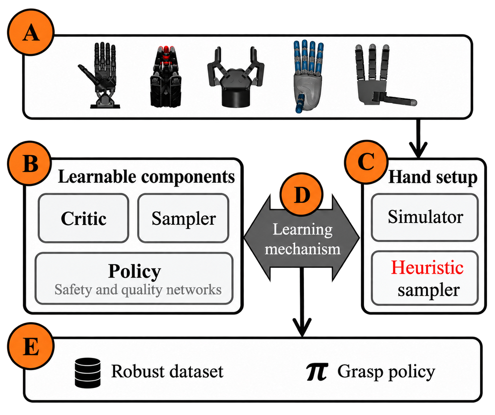
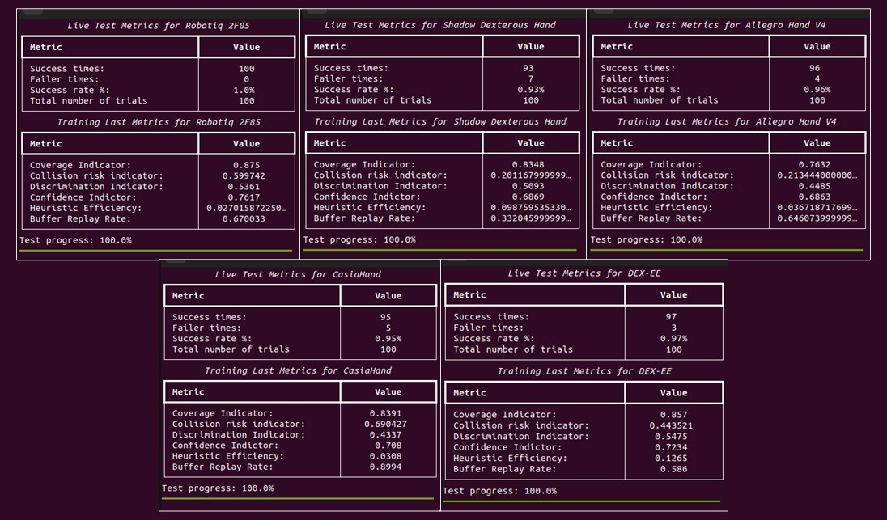

# GraspAgent_AnyHand
**GraspAgent_AnyHand** implements an adversarial learning framework for training grasp policies across heterogeneous robotic hands. It includes pretrained models for five hands and supports configuring a new hand for training in approximately 15 minutes.

<div align="center">
  
</div>
(A) The framework takes a robot hand as input. (B) The proposed learned components include neural networks used at inference (Sampler, safety and quality networks), and a critic network used only for training. (C) The engineering part for a given hand includes setting up the simulator and defining heuristic rules. (D) We propose an adversarial learning mechanism. (E) The framework outputs a grasp policy and a robust grasp pose dataset for the hand.

## Supported Robotic Hands

The repository includes trained models for five heterogeneous robotic hands:

- Shadow Dexterous Hand
- DEX-EE (Shadow three-finger hand)
- CasiaHand
- Allegro Hand V4
- Robotiq 2F85

Except for CasiaHand which was designed in our Lab, all hands are brought from the open source repository [mujoco_menagerie](https://github.com/google-deepmind/mujoco_menagerie) with modification applied to each hand including changing the reference point and adding a mocap body.


## Checkpoints and Datasets
Get the checkpoints and datasets from this [link](https://anonymous-hf.com/a/nlm8uiuqaius/). Copy all downloaded folders into the root of this repository (the same folder as this README.md), overwriting any existing files when prompted.

## Prerequisites
The following software versions were used during development:

<div align="center">

| Package | Version  |
|---|:--------:|
| Python | 3.10.16  |
| PyTorch |  2.5.1   |
| Open3D |  0.18.0  |
| CUDA |   12.6   |
| MuJoCo |  3.8.0   |
| spconv (GPU)|  2.3.8   |
| MinkowskiEngine (CPU)|  0.5.4   |

</div>
A compatible NVIDIA GPU and CUDA environment are required for GPU-accelerated training. Ensure that your installed PyTorch build and NVIDIA driver are compatible with your CUDA setup.

The sparse encoder backbone used by the critic network during training is selected automatically at runtime:

- **CUDA available** → the `spconv` backbone is used.
- **No CUDA** → the `MinkowskiEngine` backbone is activated instead of `spconv`.

Install `MinkowskiEngine` if you intend to train without CUDA.

## Evaluating a Trained Policy

To evaluate a pretrained policy, run the corresponding script in the `test_board/` directory.

### Command-line Arguments

<div align="center">

|  Argument   | Type  | Default  | Description |
|:-----------:|:-----:|:--------:|---|
|  `--view`   | bool  | `false`  | Open the MuJoCo viewer during evaluation. |
|  `--steps`  |  int  |   `10`   | Number of evaluation steps. |
| `--min_obj` |  int  |   `5`    | Minimum number of objects per scene. |
| `--max_obj` |  int  |   `15`   | Maximum number of objects per scene. |

</div>

### Example

Replace `<hand_script>` with the appropriate script for your target hand. This command enables visualization and runs 10 evaluation steps.
```bash
python test_board/<hand_script>.py --view true --steps 10
```
Note: Run from a terminal to see the live metrics table.

### Results
We run an example test for each of the five hands over 100 steps. At every step, a new scene is synthesized by randomly dropping objects from a pool of 500+ objects. Each scene contains between 5 and 15 objects.
<div align="center">
  
</div>


## Final notes
Objects used in Mujoco simulator are pre-processed using the Collision-Aware Approximate Convex Decomposition (CoACD) method. The processing method is available [here](./sim_dexee/utils/generate_mesh_xml.py)

## Credits

This work was conceptualized and implemented by **Taqiaden Alshameri** during his research at the Peng Wang Laboratory of Robot Learning and Intelligent Systems, Institute of Automation, Chinese Academy of Sciences.

- **Daheng Li** contributed to the early establishment of the simulation environment and to solving design issues related to the CasiaHand.

- **Sizhe Wang** collected the 500+ objects used in this work.